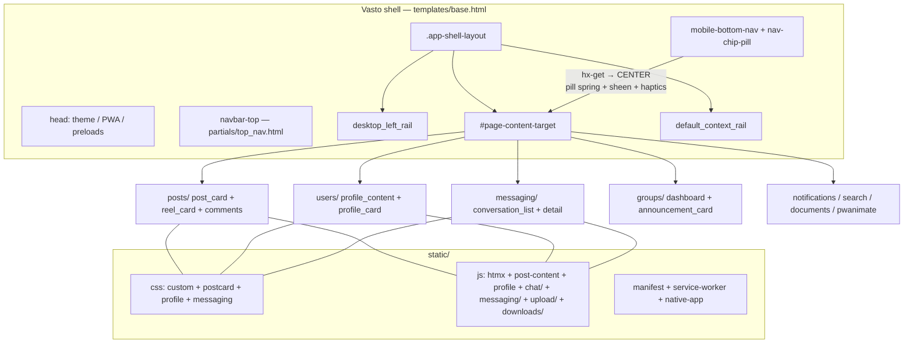

# FrontendMap — Vasto

> Site name is Vasto. Technical namespace remains `pwaninet` for app-ids, template paths, and static references. Reference for all team members.
>
> Architecture: Django templates + HTMX (`#page-content-target` swaps) + vanilla CSS/JS. No SPA build step.

## 1. Top-level layout

```
pwaninet/
  templates/base.html              # Vasto app shell, global CSS/JS, header + mobile nav
  templates/partials/
    top_nav.html                   # desktop top bar (logo, theme, avatar)
    desktop_left_rail.html         # desktop left nav (≥992px)
    default_context_rail.html      # desktop right rail
    status_modal.html / push_notification_bottom_sheet.html
  static/
    css/custom.css                 # theme vars, .post-card base, nav overrides
    css/postcard.css               # feed / reel cards
    css/profile.css                # profile pages
    css/messaging/ chat/ downloads/ pwanimate/
    js/htmx.min.js / navigation-progress.js / htmx boot
    js/home-content.js post-content.js profile.js hls_player.js
    js/chat/ messaging/ upload/ downloads/ notifications/ shared/ storage/ services/
    images/ fonts/ vendor/pdfjs/
    manifest.webmanifest service-worker.js
  www/index.html / offline.html    # Capacitor wrapper
  posts/templates/posts/           # feed, post_card, reel_card, comments
  users/templates/users/           # profile, private_profile, update_profile
  messaging/templates/messaging/   # conversation_list, conversation_detail_refactored
  groups/templates/groups/         # dashboard, group_chat, announcement_card
  notifications/ search/ documents/ courses/ pwanimate/ # feature frontends
```

Feature pattern: `*/templates/<app>/<page>.html` = full page, `*/partials/*_content.html` = HTMX fragment swapped into `#page-content-target`, `*_navigation_partial.html` = HTMX history title helper.

## 2. App shell — `templates/base.html:1`

* Head: theme/chat-theme/font-scale/font-family init to avoid FOUC, PWA manifest, preloads `custom.css`, `postcard.css`, bootstrap.
* Body grid: `.app-shell-layout` `templates/base.html:300` — 3-zone desktop: `220-240px | 800px center | 340px context`. Guest/chat shells collapse to single column.
* Header: `<nav id="navbar-top">` `templates/base.html:2529` includes `partials/top_nav.html:1`.
* Mount: `#page-content-target` — all `hx-get + hx-push-url` navigation swaps here, nav itself stays mounted.
* Scripts tail: bootstrap, `status-modal.js`, `reaction-sound.js`, `post-content.js`, `profile.js`, `hls_player.js`, `document-viewer.js`, upload/download managers (ES modules).

## 3. Bottom mobile nav + pill — `templates/base.html:3462`

`` → `<div class="mobile-bottom-nav d-md-none">` only when `user.is_authenticated`, hidden `≥768px` (`base.html:2242`).

Chips (6x `.nav-chip` with `hx-get → #page-content-target`):
Home `/`, Groups `/groups` + `.nav-groups-dot`, Chats `/messaging` + `.messages-badge`, Post `/post/new`, Notifications + `.notification-badge#notification-badge-container`, Profile `/user/<name>` + `.nav-profile-avatar` or `bi-person-circle`.

Components:
* Bar: `base.html:768` — `fixed bottom:max(14px,safe-area) 68px h, 460px max, radius 34px`, glass `blur(26px) saturate(180%)`, `::before` pointer sheen `--mx/--my`, `::after` 1px glass rim.
* Pill: `base.html:860` `.nav-chip-pill absolute 52px h` — injected `base.html:1077`, spring physics `base.html:1109 STIFFNESS 0.16 / DAMPING 0.76`, `measure/snap/start/loop`, syncs on `click/popstate/htmx:historyRestore/resize/orientationchange/ResizeObserver`.
* Position: `base.html:216 setMobileNavPosition()` — `localStorage mobileNavPosition` → `html[data-mobile-nav-position=top|bottom]`. Top mode = seamless unified header (`base.html:1904`), bottom mode = floating pill. Also `custom.css:689,816`.
* States: `body.modal-open .mobile-bottom-nav{display:none}`, `keyboard-open` handling, `in-conversation-active / reels-active / pwanimate-active` hide rules in `conversation-detail.css:4948`, `postcard.css:2103`, `pwanimate.css:2242`.
* Haptics: `static/js/services/haptics-service.js:333,382` — `data-haptic="light"` on each chip.

Edit nav here, not in `top_nav.html` (that's desktop/tablet only).

## 4. Postcards — feed unit

* Markup: `posts/templates/posts/partials/post_card.html`, list `post_cards_list.html`, detail `post_detail_content.html`, reels `reel_card.html + reels_carousel.html`, comments `comments_section.html / comment_item.html`, like `like_button.html`, link preview `link_preview_card.html`.
* Style: `static/css/postcard.css` (full) + critical first-paint copy `base.html:406 .post-card / .postcard-actions / .engagement-button 38px pill (34px ≤480px)` + theme overrides `static/css/custom.css:146,189`.
* Behaviour: `static/js/post-content.js`, `static/js/home-content.js`, `static/js/auto_video_play.js`, `static/js/hls_player.js`, `static/js/global-audio-manager.js`. Card root: `.post-card[data-post-id]` with `.post-text-clamp + .see-more-btn` (`base.html:527`), `.postcard-actions` 3x `.engagement-button` (like/comment/share).
* Anchors: `#post-card-<id> / #shared-post-card-<id>` used by notifications deep-links.

## 5. Profile card

* Pages: `users/templates/users/profile.html` → `partials/profile_content.html:12 .post-card.profile-card` (cover + avatar + stats + actions), `partials/profile_context_rail.html:8`, completion card `#profile-completion-card:295`, edit `update_profile.html`, private `private_profile.html`, fullscreen `profile_photo_fullscreen.html`.
* Style: `static/css/profile.css` + `static/css/people-modal.css`, avatar reuse `.avatar-img 38px` (`base.html:605`) and `.nav-profile-avatar 22px` in nav.
* Behaviour: `static/js/profile.js`, `static/js/password-strength.js` (register), lazy avatars `static/js/lazy-load-images.js`.

## 6. Messaging / Chat

* Pages: `messaging/templates/messaging/conversation_list.html`, `conversation_detail_refactored.html` (WhatsApp layout → hides mobile nav).
* CSS: `static/css/messaging/conversation-detail.css`, `media-composer.css`, `chat-presets.css`, `static/css/chat/telegram-media.css`.
* JS: `static/js/chat/core/{bootstrap,app-controller,store,websocket,message-service}.js`, `features/composer/MediaComposer.js + UploadQueue.js + CroppingEngine.js`, `features/voice/`, `emoji/`, `attachments/`, `shared/api/messaging-api.js`, `static/js/messaging/offline-*.js + sync-manager.js`.

## 7. Other feature frontends

* Groups: `groups/templates/groups/groups_dashboard.html`, `group_chat.html`, `partials/announcement_card.html`, `group_post_cards_list.html`.
* Notifications: `notifications/templates/` + `static/js/notifications/push-subscription.js + push-sheet.js` + `partials/push_notification_bottom_sheet.html`.
* Search: `posts/templates/posts/search_results.html` + `.search-header/.search-inner` (`base.html:572`).
* Documents/media: `documents/templates/` + `vendor/pdfjs/ + document-viewer.js`, `static/js/media-picker/`, downloads `static/js/downloads/ + static/css/downloads/offline_media_viewer.css`.
* Pwanimate (Spark AI): `pwanimate/templates/pwanimate/` incl `partials/person_card.html:120 data-profile-card-url`, `static/css/pwanimate/pwanimate.css`, `static/js/pwanimate/pwanimate-chat.js`.
* PWA/native: `static/manifest.webmanifest`, `static/service-worker.js`, `static/js/native-app.js + native-pwa-install.js`, `capacitor.config.json`, `android/`.

## 8. Entry points

1. `templates/base.html:2529,3462` — header + mobile nav markup.
2. `templates/base.html:738,1067` — pill CSS + JS (promote to `custom.css` if extracting from inline).
3. `posts/templates/posts/partials/post_card.html` + `static/css/postcard.css` — feed.
4. `users/templates/users/partials/profile_content.html:12` + `static/css/profile.css` — profile.
5. `messaging/templates/messaging/conversation_detail_refactored.html` — chat (note nav-hide guards).

## 9. Structure diagram


